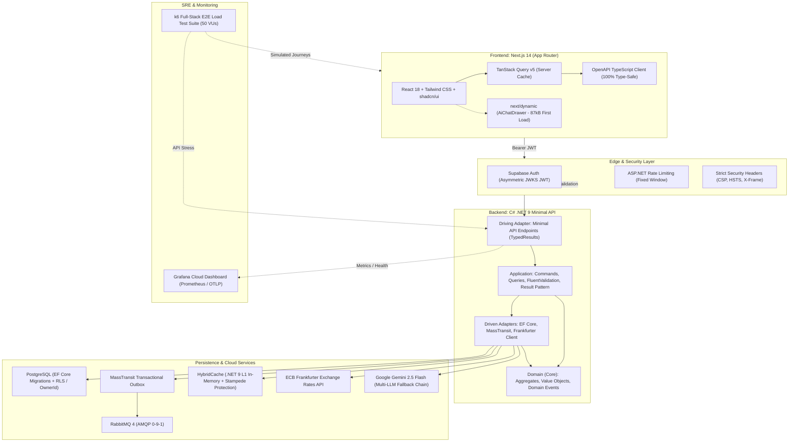

# 📈 MarketPulse Lab: Intelligent Currency & Market Watchlist Hub

[](https://github.com/poferrari/agentic-pipeline-lab/actions/workflows/ci.yml)
[](https://github.com/poferrari/agentic-pipeline-lab/actions/workflows/frontend-ci.yml)
[](https://dotnet.microsoft.com/)
[](https://nextjs.org/)
[](docs/architecture/STACK_AND_DECISIONS.md)
[](https://pagespeed.web.dev/)
[](docs/specs/market-pulse-lab-qa-report.md)
[](https://sonarcloud.io/summary/new_code?id=poferrari_agentic-pipeline-lab)
[](LICENSE)

> **Autonomous Agentic Engineering Testbed**: This repository represents the live testbed and delivered software created through the **Enterprise Agentic Software Development Pipeline** — proving that collaborative specialized AI agents operating under strict **Definition of Ready (DoR)**, **Definition of Done (DoD)**, and automated quality gates can deliver scalable, low-cost, and secure production software end-to-end.

---

## 🎯 Project Purpose & Mission

Modern software development often suffers from architectural erosion, unvalidated assumptions, code bloat, and costly operational overhead. **MarketPulse Lab** was engineered to validate a radical standard:

1. **Autonomous Pair-Programming at Enterprise Quality**: Features flow from Product Discovery (`product-requirements-analyst`) → Domain & Architecture Specification (`domain-architect-planner`) → Test-Driven C# & TypeScript implementation (`backend-csharp-developer` & `frontend-web-developer`) → Rigorous OWASP & Clean Code Review (`qa-security-reviewer`) → Infrastructure as Code & Observability (`devops-ci-engineer`).
2. **Low-Cost MVP with High Scalability**: Maximize commodity delegation (Supabase Auth for JWKS JWT, Cloud PostgreSQL, RabbitMQ MassTransit Outbox, and .NET HybridCache) to achieve sub-dollar or free-tier hosting for early-stage validation, with a seamless horizontal scaling path.
3. **Zero Security Compromise**: Enforcing strict OWASP API Security Top 10 rules, automated Gitleaks/Trivy secret scanning, zero secrets committed in version control, and strict BOLA/IDOR protection.

---

## 🏛️ System Architecture

The project is built as a **Modular Hexagonal Full-Stack Solution**, composed of an ASP.NET Core Minimal API backend and a Next.js 14 App Router frontend:



---

## 💡 Architectural Decisions & Technical Rationale (The "Why")

| Component / Pattern | Technology Chosen | Technical Rationale |
| :--- | :--- | :--- |
| **Architectural Style** | **Hexagonal (Ports & Adapters)** | Complete domain isolation. The `App.Domain` project has **zero third-party dependencies**, ensuring business rules remain completely immune to database, HTTP, or message broker changes. |
| **Backend API** | **ASP.NET Core Minimal APIs (.NET 9)** | Ultra-high throughput and micro-footprint (under 60MB RAM cold start). Organized using endpoint mappers, returning RFC 7807 `ProblemDetails` and typed results (`TypedResults`). |
| **Error Handling** | **Result Pattern (`Result<T>` / `Error`)** | Zero business logic flow control via exceptions. Exceptions are strictly reserved for catastrophic system faults; domain and validation failures return explicit, typed result objects. |
| **Web Frontend** | **Next.js 14 (App Router) + TypeScript** | React Server Components for critical shell layout, client boundaries isolated to interactive components, achieving **100/100 Desktop and 99/100 Mobile PageSpeed**. |
| **State Management** | **TanStack Query v5** | Eliminates manual `useEffect` fetching bugs. Employs Query Key factories, automatic cache invalidation on mutations, and background synchronization without global store bloat. |
| **Type Safety** | **`openapi-typescript` + C# OpenAPI** | 100% End-to-End Type Safety. TypeScript API client contracts are generated directly from backend Swagger/OpenAPI endpoints; zero manual interface synchronization. |
| **Two-Tier Caching** | **.NET `HybridCache`** | Combines L1 in-memory caching with built-in cache stampede protection. High-frequency currency rate queries avoid overwhelming external rate APIs. |
| **Authentication** | **Supabase Auth (JWKS JWT)** | Commodity delegation. Backend verifies asymmetric RS256/ES256 signatures via Supabase JWKS endpoints without custom password tables or database lookups. Includes fallback demo headers for sandbox tests. |
| **Messaging & Consistency** | **RabbitMQ + MassTransit Outbox** | The **Transactional Outbox Pattern** guarantees that state changes and domain events are committed atomically to PostgreSQL before publishing to RabbitMQ, preventing dual-write inconsistencies. |
| **Contextual AI Copilot** | **Google Gemini 2.5 Flash + Fallback Chain** | Built behind an outbound port interface (`IAiMarketAdvisorPort`). If the primary LLM quota is exceeded or unavailable, the system cascades to secondary providers and domain financial heuristics without breaking user experience. |
| **Observability** | **Grafana Cloud + OpenTelemetry** | Real-time SRE metrics tracking request latency, throughput, error rates grouped by `(http_route, http_response_status_code)`, with incident panels and k6 load verification. |

---

## 🛡️ Security, Privacy & OWASP API Top 10 Compliance

This codebase underwent rigorous offensive and defensive audits verified via automated pipelines:

1. **BOLA / IDOR Defense (API1:2023)**:
   - All watchlist mutations and queries enforce ownership checks against the authenticated user's `sub` / `OwnerId`. Users cannot inspect or delete items belonging to other tenants.
2. **Mass Assignment Protection (API3:2023)**:
   - Internal EF Core entities are never bound directly to HTTP endpoints. Immutable `record` DTOs with strict `FluentValidation` and frontend `Zod` schemas validate all inputs.
3. **Unrestricted Resource Consumption (API4:2023)**:
   - Built-in ASP.NET rate limiting enforces a fixed window policy (`60 requests/minute` per IP/User).
   - Strict pagination caps (`PageSize <= 100`) prevent runaway database queries.
4. **Zero Secret Leaks Policy (API8:2023)**:
   - Every commit and pull request runs automated scans via **Gitleaks** and **Trivy**.
   - No credentials, tokens, connection strings, or sensitive PII are committed to git history or outputted to logs.
5. **Security Headers**:
   - Production responses include strict security headers: `X-Content-Type-Options: nosniff`, `X-Frame-Options: DENY`, `Referrer-Policy: strict-origin-when-cross-origin`, and `Content-Security-Policy`.

---

## 🎨 User Experience (UX), Usability & Accessibility (a11y)

The frontend is built to provide consumer-grade delight combined with financial-tool clarity:

* **PageSpeed Insights Verified**:
  * **Desktop**: Score **100/100** | FCP 0.4s | LCP 0.6s | CLS 0.000 | TBT 0ms.
  * **Mobile**: Score **99/100** | FCP 0.8s | LCP 0.9s | CLS 0.000 | Speed Index 0.8s.
* **Cognitive Usability & Nielsen Heuristics**:
  * **The 4 Mandatory States**: Every component handles *Loading* (structural skeletons with `animate-pulse`), *Empty State* (friendly message + primary action), *Error State* (human-readable RFC 7807 ProblemDetails + 1-click retry button), and *Success/Data State*.
  * **Zero Layout Shift (CLS = 0.000)**: Explicit aspect ratio boxes prevent content jumping during async loading.
  * **Fitts's Law on Mobile**: Interactive targets maintain a minimum size of **44x44px** with actions placed within comfortable thumb reach.
* **Deep Accessibility (WCAG 2.1 AA & WCAG 2.5.3)**:
  * Color contrast ratios strictly exceed 4.5:1 (5.5:1+ in dark mode).
  * *Label in Name* compliance ensures buttons with visual text share identical accessible names for screen readers and voice navigation.
  * Modals and drawers feature focus trap confinement and `Escape` key dismissal.
  * Live rate ticker updates announce changes politely via `aria-live="polite"`.

---

## 🧪 Comprehensive Automated Test Matrix (79 Tests Passing)

All tests execute automatically in GitHub Actions with zero warnings (`-warnaserror`):

```text
========================================================================================
Suite                               Framework / Tools                      Tests Passing
========================================================================================
Backend Unit Tests                  xUnit + FluentAssertions + NSubstitute   43 Passed
Backend Architecture Tests          NetArchTest.Rules                        3 Passed
Backend Integration Tests           WebApplicationFactory + Testcontainers   19 Passed
                                    (Real PostgreSQL 17 & RabbitMQ 4)
Frontend Unit & MSW Tests           Vitest + React Testing Library + MSW     14 Passed
----------------------------------------------------------------------------------------
Total Automated Test Suite                                                   79 Passed
========================================================================================
```

### k6 Full-Stack E2E Load Test Battery
The repository includes an automated k6 stress and capacity test suite ([`tests/load/k6-fullstack-e2e-suite.js`](tests/load/k6-fullstack-e2e-suite.js)):
* Simulates multi-user journeys executing frontend page loads, live currency rates queries, alert creations/deletions, and AI copilot queries.
* Confirmed **0% 5xx server errors** and active rate-limiting (429) protecting the single-instance 512MB container.

---

## 📁 Repository Structure

```text
.
├── .agents/                        # Specialized subagent definitions and skills
│   ├── agents/                     # orchestrator, architect, backend, frontend, qa, devops, legal
│   └── skills/                     # csharp-hexagonal-ddd, frontend-api-architecture, sre, owasp
├── .github/workflows/              # GitHub Actions CI/CD workflows
│   ├── ci.yml                      # Backend strict build, unit/arch/integration tests, Trivy, Docker
│   └── frontend-ci.yml             # Frontend lint, strict typecheck, Vitest, MSW, SonarCloud
├── docs/                           # Living technical documentation
│   ├── architecture/               # Stack decisions, ADRs (ADR-001)
│   ├── dashboards/                 # Grafana Cloud dashboard definitions (MarketPulse Health)
│   ├── pipeline/                   # Definition of Ready (DoR) and Definition of Done (DoD)
│   └── specs/                      # Product specs, QA security reports, test evidence
├── src/
│   ├── backend/                    # Modular Hexagonal Monolith (.NET 9 C#)
│   │   ├── src/App.Domain/         # Domain entities, Value Objects, Domain Events, Ports
│   │   ├── src/App.Application/    # Use cases, Commands, Queries, FluentValidation, Result pattern
│   │   ├── src/App.Infrastructure/ # EF Core Postgres, RabbitMQ Outbox, HybridCache, Gemini LLM
│   │   ├── src/App.Api/            # Minimal APIs, Security middlewares, RFC 7807 ProblemDetails
│   │   └── tests/                  # App.UnitTests, App.ArchTests, App.IntegrationTests
│   └── frontend/                   # Modern Web Application (Next.js 14 App Router)
│       ├── src/app/                # Server-rendered layouts, dynamic AI chat drawer injection
│       ├── src/features/           # Feature slices: rates, watchlist, ai, auth, architecture
│       ├── src/lib/api/            # Typed OpenAPI client, Supabase Auth session injector
│       └── src/components/ui/      # Accessible design system primitives (shadcn/ui + Tailwind)
├── tests/load/                     # k6 full-stack load and stress test suites
├── Dockerfile                      # Multi-stage secure Alpine container (non-root $APP_UID)
├── docker-compose.yml              # Local development stack (API + PostgreSQL 17 + RabbitMQ 4)
└── render.yaml                     # Infrastructure as Code (Render Cloud Container Blueprint)
```

---

## 🚀 Getting Started Locally

### Prerequisites
* [.NET 9 SDK](https://dotnet.microsoft.com/download/dotnet/9.0)
* [Node.js 20+ (LTS)](https://nodejs.org/)
* [Docker & Docker Compose](https://www.docker.com/)

### 1. Run the Backend API
```bash
cd src/backend
dotnet restore
dotnet build --configuration Release -warnaserror
dotnet run --project src/App.Api
```
The API starts on `http://localhost:8080`.
* **Swagger / OpenAPI Documentation**: `http://localhost:8080/swagger`
* **Liveness Probe**: `http://localhost:8080/health/live`
* **Readiness Probe**: `http://localhost:8080/health/ready`

### 2. Run with Docker Compose (PostgreSQL 17 + RabbitMQ 4)
To run the full stack locally with real database and message broker:
```bash
docker compose up -d --build
```

### 3. Run the Frontend Web Application
```bash
cd src/frontend
npm install
npm run dev
```
Open `http://localhost:3000` in your browser.

### 4. Execute All Automated Tests
```bash
# Run backend tests (Unit, Arch, and Integration with Testcontainers)
dotnet test src/backend/MarketPulse.sln

# Run frontend tests (Vitest + MSW)
cd src/frontend
npm run test
```

---

## 🌐 Live Deployments & Cloud Endpoints

The project is continuously deployed to production containers on Render:

| Service | Live URL | Description |
| :--- | :--- | :--- |
| **Web Frontend** | [`https://agentic-pipeline-lab-web.onrender.com/`](https://agentic-pipeline-lab-web.onrender.com/) | Next.js 14 Web Application |
| **Backend REST API** | [`https://agentic-pipeline-lab-api.onrender.com/`](https://agentic-pipeline-lab-api.onrender.com/) | C# .NET 9 Minimal API |
| **Liveness Check** | [`/health/live`](https://agentic-pipeline-lab-api.onrender.com/health/live) | Health probe for orchestrators |
| **Swagger UI** | [`/swagger`](https://agentic-pipeline-lab-api.onrender.com/swagger) | Interactive API exploration |
| **Grafana SRE** | [Grafana Cloud Dashboard](https://bigveranda1683.grafana.net/d/povdvxv/9de3a08) | Real-time Observability & Telemetry |

---

## 📄 License

This project is licensed under the **MIT License** — see the [LICENSE](LICENSE) file for details.
