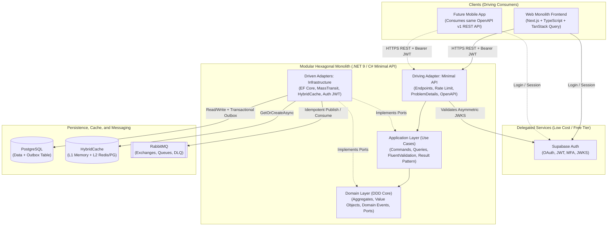

# Official Architecture, Technology Stack, and Industry Decisions (Low-Cost MVP & Scale-Ready)

This document consolidates market analysis and standard architectural decisions for this agentic pipeline. It serves as the single source of truth for all agents to prevent rework, guesswork, or architectural drift.

---

## 1. Architectural Overview



---

## 2. FinOps Strategy: Minimum Cost for MVP with Guaranteed Scale

To launch an MVP with costs between **US\$ 0 and US\$ 5/month** without sacrificing enterprise architecture capable of scaling to hundreds of thousands of users:

| Component | Recommended Choice | Why use in MVP (Buy over Build) | Initial Cost (MVP) | Scaling Path |
| :--- | :--- | :--- | :--- | :--- |
| **Authentication & Authorization** | **Supabase Auth** | Eliminates weeks building password hashing, email recovery, social OAuth, MFA, and refresh token rotation. Provides signed JWTs (JWKS) validated locally in C# in `< 1ms` without network roundtrips. | **Free** (up to 50,000 MAUs on Free Tier) | Pro Plan or transparent JWKS migration to any OIDC-compliant provider. |
| **Relational Database** | **PostgreSQL** (Supabase DB / Neon / Container) | The open-source gold standard. Supports JSONB, Full-Text Search, partial indexes, and Row-Level Security (RLS). | **Free** (Supabase/Neon Free Tier or single VPS) | Read Replicas, Connection Pooling (Supavisor/PgBouncer), and partitioning. |
| **Messaging (Event-Driven)** | **RabbitMQ** via **MassTransit** | Decouples resource-intensive work from the HTTP API. With MassTransit + EF Core Outbox, guarantees *At-Least-Once* delivery with zero message loss. | **Free** (CloudAMQP Little Lemur or Docker container) | Dedicated RabbitMQ cluster or 1-line MassTransit driver swap to AWS SQS / Azure Service Bus. |
| **Caching** | **.NET `HybridCache`** (`IMemoryCache` L1 + optional L2) | Avoids paying for dedicated Redis on Day 1 by leveraging in-memory L1 with built-in protection against *Cache Stampede*, ready to plug Upstash Redis free tier as L2. | **Free** (In-Memory L1 + Upstash Free Tier) | Dedicated Redis Cluster without changing a single line in the `Application` layer. |
| **CI/CD & Security** | **GitHub Actions + CodeQL + Trivy + Dependabot** | Complete build automation, Testcontainers integration testing, SAST, and automated vulnerability scanning native to GitHub. | **Free** (2,000 min/mo in private repos or unlimited in public) | Self-hosted GitHub Runners if needed. |

---

## 3. Market Analysis: Why this Frontend Stack for API Consumption?

Industry standard pattern for consuming REST APIs: **Next.js (React) + TypeScript + TanStack Query v5 + OpenAPI TypeScript + Vitest/Playwright**.

1. **Largest Global Ecosystem & Knowledge Base**:
   - **React + TypeScript** holds over 70% of the enterprise frontend market, offering the most extensive documentation, library ecosystem, and LLM reasoning accuracy.
2. **Gold Standard for REST API Consumption (`TanStack Query v5` + `openapi-fetch`)**:
   - Instead of fragile `useEffect` + manual `axios/fetch` loops (which introduce race conditions, duplicate loading states, and cache bugs), **TanStack Query** manages server state declaratively (`useQuery`, `useMutation`), offering smart caching, automatic retries, pagination, *optimistic updates*, and window focus revalidation.
   - Combined with **`openapi-typescript`**, the frontend consumes the OpenAPI contract generated by the C# Minimal API and automatically derives all TypeScript types. If the backend changes a field in C#, the frontend build catches it immediately at compile time.
3. **Future Mobile App Readiness**:
   - Because business logic resides 100% in the C# Backend via standardized REST APIs and the Frontend consumes via `TanStack Query` + `Zod`, when a Mobile App is built (e.g. **React Native / Expo**), **100% of API hooks, Zod schemas, OpenAPI types, and Supabase auth logic can be reused directly**.
4. **Consolidated Frontend Testing Pyramid**:
   - **Vitest + React Testing Library**: Ultra-fast execution for components and hooks.
   - **MSW (Mock Service Worker)**: Intercepts network requests during tests, simulating the C# API with complete fidelity without fragile mock code.
   - **Playwright**: Real End-to-End browser test automation.

---

## 4. Repository Topology (Modular Monolith Monorepo)

Standard repository layout initialized and maintained by the pipeline:

```text
/
├── .agents/                          # Agentic Intelligence (Agents, Skills, Hooks)
├── .github/                          # CI/CD Workflows, PR Templates, Dependabot
├── docs/                             # Living Pipeline Documentation
│   ├── architecture/                 # Architectural Decisions (ADRs) and Diagrams
│   ├── pipeline/                     # DoR, DoD, and Pipeline Guides
│   ├── specs/                        # Technical Specs by Feature (FR, NFR, Contracts)
│   └── templates/                    # Standardized Templates
├── src/
│   ├── backend/                      # .NET Solution (C# Minimal API + Hexagonal + DDD)
│   │   ├── Directory.Build.props     # Global C# Rules (Nullable, TreatWarningsAsErrors, Analyzers)
│   │   ├── src/
│   │   │   ├── App.Domain/           # Pure Core: Aggregates, Value Objects, Domain Events, Ports
│   │   │   ├── App.Application/      # Use Cases: Commands, Queries, Validators, Result Pattern
│   │   │   ├── App.Infrastructure/   # Adapters: EF Core (Postgres), MassTransit (RabbitMQ), Cache, Auth
│   │   │   └── App.Api/              # Entrypoint: Minimal APIs, Endpoints, Middlewares, OpenAPI
│   │   └── tests/
│   │       ├── App.UnitTests/        # xUnit + FluentAssertions + NSubstitute (Domain & Application)
│   │       ├── App.ArchTests/        # NetArchTest (Enforces Hexagonal Architecture Rules)
│   │       └── App.IntegrationTests/ # WebApplicationFactory + Testcontainers (Postgres + RabbitMQ)
│   └── frontend/                     # Web Monolith (Next.js / React + TypeScript)
│       ├── src/
│       │   ├── app/                  # Routes and Layouts (App Router)
│       │   ├── components/           # UI Components (shadcn/ui + Domain Components)
│       │   ├── features/             # Feature Modules (TanStack Query hooks, Zod forms, views)
│       │   ├── lib/                  # Typed API Client (openapi-fetch), Supabase Client, utils
│       │   └── test/                 # Vitest Setup, MSW handlers and factories
│       └── e2e/                      # End-to-End Tests with Playwright
└── docker-compose.yml                # Local Infra: PostgreSQL + RabbitMQ (with Management UI)
```
