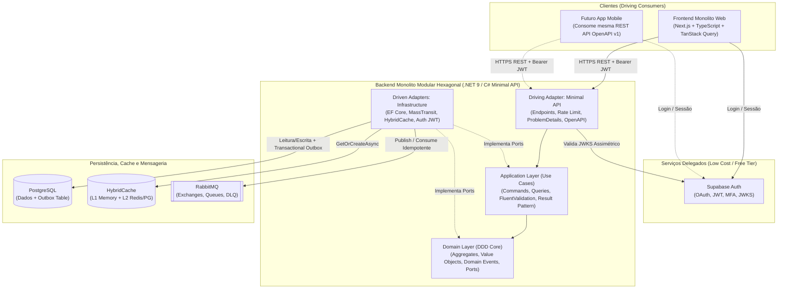

# Arquitetura Oficial, Stack Tecnológica e Decisões de Mercado (MVP Low-Cost & Scale-Ready)

Este documento consolida a análise de mercado e as decisões arquiteturais padrão desta esteira agêntica. Ele serve como fonte da verdade para todos os agentes para evitar re-trabalho ou escolhas tecnológicas inconsistentes.

---

## 1. Visão Geral da Arquitetura



---

## 2. Estratégia FinOps: Menor Custo para MVP com Escala Garantida

Para lançar um MVP com custo próximo de **US\$ 0 a US\$ 5/mês** sem sacrificar arquitetura enterprise que escala para centenas de milhares de usuários:

| Componente | Escolha Recomendada | Por que usar no MVP (Buy over Build) | Custo Inicial (MVP) | Caminho de Escala |
| :--- | :--- | :--- | :--- | :--- |
| **Autenticação & Autorização** | **Supabase Auth** | Elimina semanas criando hash de senha, recuperação de e-mail, OAuth social, MFA e refresh tokens. Fornece JWT assinado (JWKS) validado localmente pelo C# em `< 1ms` sem custo de rede por request. | **Grátis** (até 50.000 MAUs no Free Tier) | Pro Plan ou migração transparente de JWKS para qualquer OIDC compatível. |
| **Banco de Dados Relacional** | **PostgreSQL** (Supabase DB / Neon / Container) | Padrão ouro open-source. Suporta JSONB, Full-Text Search, índices parciais e Row-Level Security (RLS). | **Grátis** (Supabase/Neon Free Tier ou VPS única) | Read Replicas, Connection Pooling (Supavisor/PgBouncer) e particionamento. |
| **Mensageria (Event-Driven)** | **RabbitMQ** via **MassTransit** | Desacopla processamento pesado da API HTTP. Com MassTransit + EF Core Outbox, garante entrega *At-Least-Once* sem perder mensagens. | **Grátis** (CloudAMQP Little Lemur ou Docker na mesma VPS) | Cluster RabbitMQ dedicado ou troca de 1 linha no MassTransit para AWS SQS / Azure Service Bus. |
| **Cache** | **.NET `HybridCache`** (`IMemoryCache` L1 + opcional L2) | Evita pagar Redis dedicado no dia 1 usando memória local (L1) com proteção nativa contra *Cache Stampede*, já preparado para plugar Redis (Upstash free tier) como L2. | **Grátis** (In-Memory L1 + Upstash Free Tier) | Redis Cluster dedicado sem alterar uma única linha na camada `Application`. |
| **CI/CD & Segurança** | **GitHub Actions + CodeQL + Trivy + Dependabot** | Automação completa de build, testes com Testcontainers, SAST e auditoria de vulnerabilidades nativos do GitHub. | **Grátis** (2.000 min/mês em repos privados ou ilimitado em públicos) | GitHub Runners auto-hospedados se necessário. |

---

## 3. Análise de Mercado: Por que esta Stack de Frontend para Consumo de API?

O usuário solicitou: *"frontend preciso que voce busque o que o mercado recomenda para uso de API, o que tem mais de informacao disponivel. testes precisam existir"*.

### Escolha Vencedora do Mercado: **Next.js (React) + TypeScript + TanStack Query v5 + OpenAPI TypeScript + Vitest/Playwright**

1. **Maior Ecossistema e Documentação do Mundo**:
   - **React + TypeScript** detém mais de 70% do mercado enterprise frontend e a maior base de conhecimento, exemplos, bibliotecas e suporte para LLMs/Agentes.
2. **Padrão Ouro para Consumo de REST API (`TanStack Query v5` + `openapi-fetch`)**:
   - Em vez de usar `useEffect` + `axios/fetch` manual (que gera bugs de race condition, estados de loading duplicados e falta de cache), o **TanStack Query** gerencia estado do servidor declarativamente (`useQuery`, `useMutation`), com cache inteligente, retries automáticos, paginação, *optimistic updates* e revalidação em foco.
   - Combinado com **`openapi-typescript`**, o frontend lê o contrato OpenAPI gerado pela Minimal API C# e cria todos os tipos TypeScript automaticamente. Se o backend mudar um campo em C#, o build do frontend avisa no mesmo segundo em tempo de compilação!
3. **Preparação para Futuro App Mobile**:
   - Como a regra de negócio fica 100% no Backend C# via REST API padronizada e o Frontend consome via `TanStack Query` + `Zod`, quando o App Mobile for criado (ex.: **React Native / Expo**), **100% dos hooks de API, schemas Zod, tipos OpenAPI e lógica de autenticação Supabase podem ser reaproveitados diretamente**.
4. **Pirâmide de Testes Frontend Consolidada**:
   - **Vitest + React Testing Library**: Execução ultrarrápida para componentes e hooks.
   - **MSW (Mock Service Worker)**: Intercepta requisições na camada de rede durante os testes, simulando a API C# com fidelidade total sem mocks frágeis de código.
   - **Playwright**: Testes End-to-End reais automatizados no navegador.

---

## 4. Estrutura de Pastas Padrão do Repositório (Monorepo Monolito Modular)

Quando a esteira inicializar ou organizar o código do projeto, esta é a topologia recomendada:

```text
/
├── .agents/                          # Inteligência Agêntica (Agentes, Skills, Hooks)
├── .github/                          # Workflows CI/CD, Templates de PR, Dependabot
├── docs/                             # Documentação Viva da Esteira
│   ├── architecture/                 # Decisões Arquiteturais (ADRs) e Diagramas
│   ├── pipeline/                     # DoR, DoD e Guias da Esteira
│   ├── specs/                        # Especificações Técnicas por Feature (RF, RNF, Contratos)
│   └── templates/                    # Templates padronizados
├── src/
│   ├── backend/                      # Solução .NET (C# Minimal API + Hexagonal + DDD)
│   │   ├── Directory.Build.props     # Regras globais C# (Nullable, TreatWarningsAsErrors, Analyzers)
│   │   ├── src/
│   │   │   ├── App.Domain/           # Core puro: Aggregates, Value Objects, Domain Events, Ports
│   │   │   ├── App.Application/      # Use Cases: Commands, Queries, Validators, Result Pattern
│   │   │   ├── App.Infrastructure/   # Adapters: EF Core (Postgres), MassTransit (RabbitMQ), Cache, Auth
│   │   │   └── App.Api/              # Entrypoint: Minimal APIs, Endpoints, Middlewares, OpenAPI
│   │   └── tests/
│   │       ├── App.UnitTests/        # xUnit + FluentAssertions + NSubstitute (Domain & Application)
│   │       ├── App.ArchTests/        # NetArchTest (Garante regras da Arquitetura Hexagonal)
│   │       └── App.IntegrationTests/ # WebApplicationFactory + Testcontainers (Postgres + RabbitMQ)
│   └── frontend/                     # Monolito Web (Next.js / React + TypeScript)
│       ├── src/
│       │   ├── app/                  # Rotas e Layouts (App Router)
│       │   ├── components/           # UI Components (shadcn/ui + componentes de domínio)
│       │   ├── features/             # Módulos por domínio (hooks TanStack Query, forms Zod, views)
│       │   ├── lib/                  # Cliente API tipado (openapi-fetch), cliente Supabase, utils
│       │   └── test/                 # Setup Vitest, MSW handlers e factories
│       └── e2e/                      # Testes End-to-End com Playwright
└── docker-compose.yml                # Infra local: PostgreSQL + RabbitMQ (com Management UI)
```

