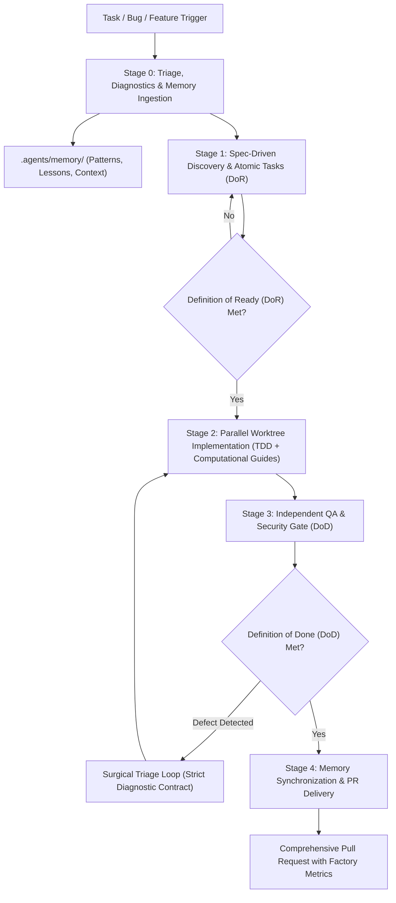

# Enterprise Agentic Software Development Ecosystem Documentation

**Repository**: `pipeline-dev-automatizador`  
**Classification**: Engineering Standard & Agentic Architecture Blueprint  
**Standard Language**: Technical English (EN-US)  
**Last Updated**: November 2026  

---

## 1. Executive Summary & Vision

The **Enterprise Agentic Software Development Ecosystem** implemented in this repository transforms artificial intelligence from an ad-hoc code-generation assistant into a **deterministic, measurable, and highly governed Autonomous Software Factory (V2)**.

By synthesizing principles from **Spec-Driven Development (SDD)**, **Uncle Bob Disciplines (`ub-mode`)**, **Hexagonal Architecture (Ports & Adapters)**, and **Harness/Factory Engineering**, this ecosystem guarantees that software is planned, designed, implemented, tested, audited, and deployed with zero ambiguity, rigorous security (OWASP API Top 10), and complete knowledge continuity.



---

## 2. Core Methodological Pillars

### 2.1. The 4 Pillars of Spec-Driven Development (SDD)
1. **Clarity**: Eliminate all ambiguous blank-canvas assumptions. Specifications must define concrete domain models, data types, HTTP status codes, error schemas, RabbitMQ integration events, and database constraints before any code is generated.
2. **Evidence**: Code is never approved merely because it compiles. Every functional and non-functional requirement must be accompanied by automated, deterministic verification tests (`Given_When_Then`, `Testcontainers`, `Vitest`).
3. **Independence**: The agent author of the code **never** evaluates or audits its own work. Verification is delegated to an independent reviewer agent (`qa-security-reviewer`) to eradicate self-confirmation bias.
4. **Continuity (Memory Bank)**: Repository memory persists across sessions in `.agents/memory/`. Decisions, architectural patterns, and previously resolved defects are stored in living documents so agents never repeat past mistakes.

### 2.2. Dual Guidance Architecture: Inferential vs. Computational
- **Inferential Guides**: Natural language instructions (System Prompts, Skills markdown, ADRs, Domain Docs). These consume context window tokens and model reasoning. They are kept concise, structured, and modular.
- **Computational Guides**: Deterministic programs executed directly on the local CPU (`dotnet build`, `dotnet format`, `NetArchTest`, `tsc --noEmit`, linters, test runners). They consume **zero tokens** and provide immediate, unarguable feedback before requesting model inference.

### 2.3. Zero-Conflict Parallel Engineering (Git Worktrees)
When multiple agents or engineers implement features simultaneously:
- Shared contracts (OpenAPI, database migrations, event schemas) are frozen in Stage 1.
- Each feature is developed in a dedicated **Git Worktree** (`git worktree add ../worktrees/<feature> -b feat/<feature>`), avoiding file collisions and dirty working trees.
- Before opening a PR, the agent executes `git rebase origin/main` and runs semantic verification to prevent silent logic collisions.

---

## 3. Specialized Autonomous Agents Catalog (`.agents/agents/`)

The pipeline comprises 8 specialized roles operating under the principle of Single Responsibility:

| Agent Name | Role & Scope | Key Tools & Disciplines |
| :--- | :--- | :--- |
| **`pipeline-orchestrator`** | Conductor of the autonomous pipeline. Coordinates workflows from Stage 0 to Stage 4, monitors hand-offs, and delegates tasks. | Subagent invocation, state tracking, Memory Bank alignment. |
| **`product-requirements-analyst`** | Product Discovery specialist. Translates briefings into Functional (FR) and Non-Functional Requirements (NFR), runs pre-mortem risk matrices, resolves Open Questions, and validates DoR. | Pre-Mortem matrix, `ask_question`, business domain modeling. |
| **`domain-architect-planner`** | System Architect. Models Strategic/Tactical DDD, Hexagonal boundaries, PostgreSQL schemas, MassTransit RabbitMQ Outbox, OpenAPI REST contracts, and decomposes atomic task lists. | ADR drafting, contract freezing, dependency graph decomposition. |
| **`backend-csharp-developer`** | Senior C# Engineer (.NET 8/9+). Implements Minimal APIs, Hexagonal layers (`Domain`, `Application`, `Infrastructure`, `Api`), Result Pattern, FluentValidation, EF Core, MassTransit Outbox, and HybridCache. | `ub-mode` (CRAP < 10, Dryer < 0.8), xUnit, `FluentAssertions`, `Testcontainers`, Stryker.NET. |
| **`frontend-web-developer`** | Senior Frontend Engineer. Implements Next.js App Router, React Server Components, strict TypeScript, TanStack Query v5, automated OpenAPI client generation, Zod forms, and Supabase Auth. | WAI-ARIA (shadcn/ui), Tailwind CSS, Vitest, React Testing Library, MSW, Playwright. |
| **`qa-security-reviewer`** | Independent Quality and Security Auditor. Enforces the Final Quality Gate (DoD), audits against OWASP API Security Top 10, verifies mutation test resilience, and detects superficial crash-guards. | OWASP checklists, NetArchTest architecture validation, code review verdicts. |
| **`devops-ci-engineer`** | Platform & SRE Engineer. Automates GitHub Actions CI/CD workflows, Docker Compose environments, FinOps optimizations, load testing (k6), and OpenTelemetry observability. | GitHub Actions, Docker, Trivy, Gitleaks, Grafana dashboards, k6 scripts. |
| **`legal-compliance-privacy-officer`** | Privacy & Data Protection Officer. Audits Brazilian LGPD (Lei 13.709/2018), GDPR, Privacy by Design, PII masking, consent lifecycles, and data minimization. | Legal risk auditing, PII redaction patterns, compliance checklists. |

---

## 4. Operational Skills Catalog (`.agents/skills/`)

Skills provide reusable, domain-specific instruction bundles and automated recipes:

### 4.1. Core Orchestration & Governance Skills
1. **`agentic-triage-and-diagnostics`** ([Documentation](file:///d:/pipeline-dev-automatizador/.agents/skills/agentic-triage-and-diagnostics/SKILL.md)):
   - Surgically isolates stack traces, CI breaks, and Sentry alerts.
   - Evaluates impact (**Low / Medium / High / Breaking**) to route to the appropriate model tier (`flash_lite`, `inherit`, `pro`).
   - Emits a strict structured JSON diagnostic contract rather than conversational prose.
2. **`repo-memory-bank`** ([Documentation](file:///d:/pipeline-dev-automatizador/.agents/skills/repo-memory-bank/SKILL.md)):
   - Manages and enforces continuity across agent sessions using `.agents/memory/`.
   - Ingests verified architectural patterns and prevents repeating documented anti-patterns.
3. **`parallel-feature-worktrees`** ([Documentation](file:///d:/pipeline-dev-automatizador/.agents/skills/parallel-feature-worktrees/SKILL.md)):
   - Manages isolated Git Worktrees for concurrent feature branches.
   - Enforces frozen contracts and post-rebase semantic verification before PR submission.
4. **`discovery-and-spec`** ([Documentation](file:///d:/pipeline-dev-automatizador/.agents/skills/discovery-and-spec/SKILL.md)):
   - Pre-mortem failure forecasting (concurrency, dual-writes, outbox retries, BOLA/IDOR, read explosion, mobile evolution, FinOps).
   - Generates comprehensive technical specs (`docs/specs/<feature>.md`) and atomic tasks (`docs/specs/<feature>-tasks.md`).
5. **`run-agentic-pipeline`** ([Documentation](file:///d:/pipeline-dev-automatizador/.agents/skills/run-agentic-pipeline/SKILL.md)):
   - Orchestrates the full autonomous factory lifecycle across all subagents.
6. **`pr-delivery-automation`** ([Documentation](file:///d:/pipeline-dev-automatizador/.agents/skills/pr-delivery-automation/SKILL.md)):
   - Runs local computational verification, Conventional Commits, updates the Memory Bank, and publishes rich Pull Requests with Factory V2 metrics.

### 4.2. Implementation & Architecture Skills
7. **`csharp-hexagonal-ddd`** ([Documentation](file:///d:/pipeline-dev-automatizador/.agents/skills/csharp-hexagonal-ddd/SKILL.md)):
   - C# .NET Minimal APIs with Hexagonal layer isolation, Result Pattern, MassTransit RabbitMQ Outbox, and Supabase JWT authentication.
8. **`frontend-api-architecture`** ([Documentation](file:///d:/pipeline-dev-automatizador/.agents/skills/frontend-api-architecture/SKILL.md)):
   - End-to-end type safety with Next.js, OpenAPI client codegen, TanStack Query v5, Zod schemas, and MSW testing.
9. **`software-architecture-patterns`** ([Documentation](file:///d:/pipeline-dev-automatizador/.agents/skills/software-architecture-patterns/SKILL.md)):
   - System Design, Object Calisthenics, Distributed Resilience (Circuit Breaker, Exponential Backoff + Jitter, Outbox, Idempotency).
10. **`cqrs-and-event-sourcing`** ([Documentation](file:///d:/pipeline-dev-automatizador/.agents/skills/cqrs-and-event-sourcing/SKILL.md)):
    - EventStoreDB / PostgreSQL append-only event streams, optimistic concurrency with revision control, and projections.

### 4.3. Quality, Security & Operations Skills
11. **`ub-mode`** ([Documentation](file:///d:/pipeline-dev-automatizador/.agents/skills/ub-mode/SKILL.md)):
    - Uncle Bob engineering disciplines: First make it work, then make it right, follow practice.
    - Deterministic Quality Gates: CRAP < 10, Dryer < 0.8, Mutation Testing, and strict anti-crash-guard rule.
12. **`owasp-quality-gate`** ([Documentation](file:///d:/pipeline-dev-automatizador/.agents/skills/owasp-quality-gate/SKILL.md)):
    - Comprehensive offensive and defensive security review covering the OWASP API Security Top 10.
13. **`lgpd-privacy-security-governance`** ([Documentation](file:///d:/pipeline-dev-automatizador/.agents/skills/lgpd-privacy-security-governance/SKILL.md)):
    - Brazilian LGPD and GDPR compliance, PII minimization, right to be forgotten, and consent auditing.
14. **`sre-observability-telemetry`** ([Documentation](file:///d:/pipeline-dev-automatizador/.agents/skills/sre-observability-telemetry/SKILL.md)):
    - OpenTelemetry tracing, metrics, structured logs, Grafana dashboards, and RCA incident runbooks.
15. **`mcp-painel`** ([Documentation](file:///d:/pipeline-dev-automatizador/.agents/skills/mcp-painel/SKILL.md)):
    - Inspection and management of Model Context Protocol (MCP) servers and tools.

---

## 5. Repository Memory Bank Structure (`.agents/memory/`)

The Memory Bank guarantees project continuity across disjoint agent runs:

```
.agents/memory/
├── systemPatterns.md   # Official architectural conventions, naming, layering, and libraries.
├── learnedLessons.md   # Post-mortem registry of past bugs, traps, and anti-pattern resolutions.
└── activeContext.md    # Current sprint status, active goals, and immediate next steps.
```

- **Read Policy**: Before drafting a spec or writing code, agents must ingest `systemPatterns.md` and `learnedLessons.md`.
- **Write Policy**: When closing a task or creating a PR, new findings, corrected bugs, or new reusable adapters are appended to `learnedLessons.md` and `systemPatterns.md`.

---

## 6. Strict Stage Hand-Off Contracts

To avoid noisy conversational chat between agents, hand-offs occur via strictly structured contracts:

### 6.1. Triage Diagnostic Contract (`agentic-triage-and-diagnostics`)
```json
{
  "triage_id": "TRG-20261113-01",
  "source": "CI_FAILURE | SENTRY_ALERT | USER_ISSUE",
  "impact_level": "LOW | MEDIUM | HIGH | BREAKING",
  "model_tier_recommended": "flash_lite | inherit | pro",
  "root_cause_hypothesis": "Failure root cause at origin (anti-crash-guard enforced).",
  "affected_components": [
    { "file_path": "src/.../Handler.cs", "expected_behavior": "...", "actual_behavior": "..." }
  ],
  "reproduction_test": { "test_file": "tests/.../Test.cs", "test_name": "Should_...", "test_type": "UNIT" }
}
```

### 6.2. Pull Request Delivery Contract (`pr-delivery-automation`)
Pull Requests must include the **Software Factory V2 Metrics**:
- **Impact Level**: Low / Medium / High.
- **Model Tier Employed**: Rationale for model selection.
- **Computational Verification Evidence**: Local CPU build and test results (0 tokens).
- **Independent QA Verdict**: Reference to the sign-off from `qa-security-reviewer`.
- **Memory Continuity**: Links to newly added entries in `learnedLessons.md`.

---

## 7. Quality Gates

### Definition of Ready (DoR) - [Full Checklist](file:///d:/pipeline-dev-automatizador/docs/pipeline/DEFINITION_OF_READY.md)
No task enters code generation without satisfying 100% of DoR:
- [x] Clear business value and Functional Requirements (FR).
- [x] Non-Functional Requirements (NFR) specified (latency, throughput, retention, mobile readiness).
- [x] Pre-mortem problem predictor analyzed (concurrency, outbox, RabbitMQ poison queue, BOLA/IDOR, read explosion, FinOps).
- [x] Zero unresolved Open Questions.
- [x] Technical Spec complete (`docs/specs/<feature>.md`).
- [x] Atomic tasks decomposed with verification commands (`docs/specs/<feature>-tasks.md`).

### Definition of Done (DoD) - [Full Checklist](file:///d:/pipeline-dev-automatizador/docs/pipeline/DEFINITION_OF_DONE.md)
No PR is merged without satisfying 100% of DoD:
- [x] 100% of automated unit, architecture, and integration tests passing.
- [x] Uncle Bob Deterministic Quality Gates: CRAP < 10, Dryer < 0.8, Mutation Testing verified.
- [x] Zero superficial crash-guards masking unhandled illegal states.
- [x] OWASP API Security Top 10 verified.
- [x] Zero lint or formatting warnings (`dotnet format`, `eslint`).
- [x] Memory Bank updated (`learnedLessons.md`, `activeContext.md`).
- [x] Independent sign-off from `qa-security-reviewer`.

---

## 8. Knowledge Library & External Integrations (`conhecimento/`)

The repository maintains an active knowledge ingestion pipeline that analyzes cutting-edge engineering content:
- [20261113_ANALISE_VIDEOS_FABRICA_SOFTWARE_SPEC_DRIVEN.md](file:///d:/pipeline-dev-automatizador/conhecimento/artigos/20261113_ANALISE_VIDEOS_FABRICA_SOFTWARE_SPEC_DRIVEN.md): Comprehensive synthesis of 6 videos (Full Cycle, Tech Leads Club, Rafael Quintanilha / Warp, Main Branch) covering Factory V2, the 4 SDD Pillars, and Inferential vs Computational guides.
- [20261113_DESENVOLVIMENTO_PARALELO_FEATURES_SEM_CONFLITO_WORKTREES.md](file:///d:/pipeline-dev-automatizador/conhecimento/artigos/20261113_DESENVOLVIMENTO_PARALELO_FEATURES_SEM_CONFLITO_WORKTREES.md): Complete guide to multi-agent parallel feature development using Git Worktrees, frozen contracts, and semantic conflict detection.
- [20261111_CONHECIMENTO_VIDEO_8_DESENVOLVIMENTO_SLACK_SPEC_DRIVEN_FULLSTACK.md](file:///d:/pipeline-dev-automatizador/conhecimento/artigos/20261111_CONHECIMENTO_VIDEO_8_DESENVOLVIMENTO_SLACK_SPEC_DRIVEN_FULLSTACK.md): Full-stack agent integration with messaging platforms.

