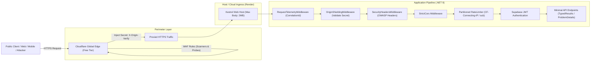

# Defense-in-Depth & Security Hardening Guide (Zero-Cost MVP Architecture)

## 1. Executive Summary & Philosophy

Modern web APIs face continuous automated reconnaissance, volumetric DDoS attacks, credential stuffing, scraping bots, and path-traversal probes. In early-stage MVPs, commercial Enterprise WAFs and dedicated API gateway clusters (e.g. Kong Enterprise, AWS WAF, Apigee) introduce unsustainable operational overhead and monthly cloud bills.

This guide outlines our **Zero-Cost ($0.00) Defense-in-Depth Strategy** specifically engineered for our stack:
* **ASP.NET Core (.NET 9 Minimal API)** deployed in lightweight multi-stage Linux containers on **Render**.
* **PostgreSQL (Supabase)** with Row-Level Security (RLS) and JWT asymmetric JWKS validation.
* **RabbitMQ (CloudAMQP)** with Transactional Outbox and Dead-Letter Queues.
* **Perimeter Defense**: Global Edge Proxy via **Cloudflare Free Tier**.



---

## 2. Layer 1: Global Edge Perimeter (Cloudflare Free Tier)

Cloudflare operates an Anycast network across 300+ global cities that inspects and filters traffic before it reaches origin servers.

### 2.1. DDoS Mitigation (Unmetered L3/L4/L7)
* Automatically absorbs volumetric SYN floods, UDP amplification, and HTTP floods at edge PoPs.
* Zero configuration required; operates out of the box in the Free Tier.

### 2.2. Bot Fight Mode
* **Dashboard Location**: *Security > Bots > Bot Fight Mode*.
* Detects and challenges automated scrapers, vulnerability scanners, and known credential-stuffing botnets.
* Saves Render container CPU and RAM by terminating bot requests at the perimeter.

### 2.3. WAF Custom Rules (5 Free Rules)
1. **Probe and Scanner Blocker**:
   - Expression:
     ```
     (http.request.uri.path contains "/wp-admin") or
     (http.request.uri.path contains "/.env") or
     (http.request.uri.path contains "/.git") or
     (http.request.uri.path contains "/phpmyadmin") or
     (http.request.uri.path contains "..")
     ```
   - Action: `Block`
2. **Geographic Filtering (Optional MVP Policy)**:
   - If servicing only specific regions (e.g., Latin America and North America):
     ```
     not (ip.geoip.country in {"BR" "US"})
     ```
   - Action: `Managed Challenge` or `Block`.

---

## 3. Layer 2: Origin Shielding (Mitigating the Render Bypass)

### The Threat
Render web services receive a default public hostname: `https://<service-name>.onrender.com`. If an attacker discovers or enumerates this hostname, they can bypass Cloudflare completely, directing attacks straight to the origin container.

### The Zero-Cost Solution
1. **Cloudflare Transform Rule (Modify Request Header)**:
   - **Dashboard Location**: *Rules > Transform Rules > Modify Request Header*.
   - **Filter**: All incoming requests (`http.request.full_uri contains "api"`).
   - **Action**: Set dynamic or static header:
     - Name: `X-Origin-Verify`
     - Value: `<CRYPTOGRAPHICALLY-SECURE-GUID-SECRET>`
2. **OriginShieldingMiddleware (.NET 9)**:
   - The application inspects every incoming request for `X-Origin-Verify`.
   - Health probes (`/health/live`, `/health/ready`) are allowed through so platform orchestrators can monitor container health.
   - Any request missing or presenting an invalid secret is immediately rejected with `403 Forbidden` and RFC 7807 `ProblemDetails` in **< 1ms**, without touching the database or message bus.

---

## 4. Layer 3: Application Hardening (C# .NET 9 Minimal API)

### 4.1. Partitioned Rate Limiting (`System.Threading.RateLimiting`)
Behind a reverse proxy or CDN, standard `context.Connection.RemoteIpAddress` resolves to the proxy's IP. Our `ResolveClientPartitionKey` ensures proper partitioning:
1. **Authenticated Users**: Partitioned by JWT claim `sub` (User ID) -> allows generous limits (e.g., 300 req/min).
2. **Cloudflare Edge Users**: Partitioned by `CF-Connecting-IP` header.
3. **Standard Proxy Users**: Partitioned by the first client IP in `X-Forwarded-For`.
4. **Local / Direct Fallback**: Partitioned by `RemoteIpAddress`.

### 4.2. OWASP Recommended Security Headers
`SecurityHeadersMiddleware` automatically attaches defensive headers to every HTTP response:
* `Content-Security-Policy`: `default-src 'self'; frame-ancestors 'none'; object-src 'none'; base-uri 'self';` (Protects against XSS and UI redress).
* `X-Frame-Options`: `DENY` (Completely prevents Clickjacking).
* `X-Content-Type-Options`: `nosniff` (Prevents MIME-confusion attacks).
* `Referrer-Policy`: `strict-origin-when-cross-origin` (Avoids leaking private path data in referrer headers).
* `X-Permitted-Cross-Domain-Policies`: `none` (Blocks cross-domain policy files).
* `Permissions-Policy`: `geolocation=(), microphone=(), camera=()` (Disables unnecessary client APIs).
* `Strict-Transport-Security`: `max-age=31536000; includeSubDomains; preload` (HSTS over HTTPS).

### 4.3. Anti-Buffer Exhaustion DoS (Kestrel Limits)
```csharp
builder.WebHost.ConfigureKestrel(options =>
{
    options.Limits.MaxRequestBodySize = 2 * 1024 * 1024; // 2 MB limit
});
```

---

## 5. Layer 4: Automated Verification Suite (Pentest Regression Tests)

The repository includes automated defensive tests in `App.IntegrationTests.Security.SecurityHardeningAndPentestVerificationTests`:

| Test Name | Threat Category | Verification Mechanism |
| :--- | :--- | :--- |
| `Responses_Must_Include_All_OWASP_Recommended_Security_Headers` | Security Misconfiguration (OWASP API8) | Asserts presence of CSP, HSTS, X-Frame, Nosniff, and Permissions-Policy on all responses. |
| `OriginShielding_WhenEnabled_ShouldAllowHealthChecksWithoutSecret` | Service Availability | Asserts `/health/live` and `/health/ready` bypass perimeter checks for container orchestrators. |
| `OriginShielding_WhenEnabled_ShouldRejectDirectOriginRequestsWithoutSecret_With403Forbidden` | Origin Exposure / Bypass | Asserts requests without `X-Origin-Verify` receive `403 Forbidden` + RFC 7807 ProblemDetails. |
| `OriginShielding_WhenEnabled_ShouldRejectRequestsWithInvalidSecret_With403Forbidden` | Header Forgery | Asserts forged or incorrect secrets are rejected with `403 Forbidden`. |
| `OriginShielding_WhenEnabled_ShouldAllowRequestsWithValidSecret` | Authorized Edge Routing | Asserts legitimate requests carrying the secret route successfully. |
| `RateLimiter_ShouldSupportCloudflareConnectingIpPartitioning` | Resource Exhaustion (OWASP API4) | Asserts separate `CF-Connecting-IP` headers are partitioned independently without noisy-neighbor starvation. |

---

## 6. Runbook: Adding a Custom Domain to Cloudflare and Pointing to Render

When ready to link a custom domain to this infrastructure:

1. **Add Domain to Cloudflare**:
   - Access [Cloudflare Dashboard](https://dash.cloudflare.com/).
   - Click **Add a domain**, enter your domain name (e.g. `yourdomain.com`), and select the **Free Plan**.
   - Update your domain registrar's NS records to the assigned Cloudflare nameservers.
2. **Create DNS CNAME Record for the API**:
   - Type: `CNAME`
   - Name: `api` (resolves to `api.yourdomain.com`)
   - Target: `agentic-pipeline-lab-api.onrender.com` (your Render service URL)
   - Proxy status: **Proxied (Orange Cloud Active)**.
3. **Configure SSL/TLS Mode**:
   - Go to *SSL/TLS > Overview*.
   - Select **Full (strict)**.
4. **Create the Origin Shield Transform Rule**:
   - Go to *Rules > Transform Rules > Modify Request Header*.
   - Create rule named `Origin Shield Secret Injection`.
   - Action: Set HTTP Request Header `X-Origin-Verify` to your chosen secret token.
5. **Set Environment Variables on Render**:
   - `ORIGIN_SHIELDING_ENABLED`: `true`
   - `ORIGIN_SHIELDING_SECRET`: `<YOUR-CHOSEN-SECRET-TOKEN>`
6. **Verify End-to-End**:
   - Direct curl to `https://agentic-pipeline-lab-api.onrender.com/` returns `403 Forbidden`.
   - Curl to `https://api.yourdomain.com/` returns `200 OK`.
