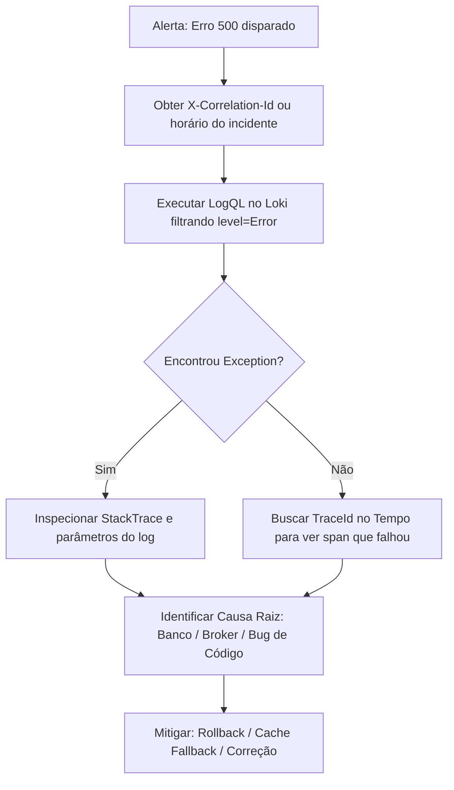

# Playbook Operacional de SRE & Investigação de Incidentes (Runbook)

Este documento é o guia de referência executável para **Engenheiros de SRE**, **Desenvolvedores** e **Agentes de IA Autônomos** investigarem anomalias, crashes, degradações de latência e incidentes de segurança no **MarketPulse Lab**.

---

## 1. Topologia da Arquitetura de Observabilidade

```
                        ┌─────────────────────────────────────────────────────────┐
                        │             MarketPulse.Api (.NET 9 C#)                 │
                        │  - System.Diagnostics.ActivitySource ("MarketPulse.Api")│
                        │  - System.Diagnostics.Metrics.Meter ("MarketPulse.Api") │
                        │  - ILogger Structured Logging Scope (CorrelationId)     │
                        └───────────────────────────┬─────────────────────────────┘
                                                    │
                                         Protocol: OTLP / HTTP (Protobuf)
                                         W3C TraceContext (traceparent)
                                                    │
                   ┌────────────────────────────────┴────────────────────────────────┐
                   │                                                                 │
                   ▼                                                                 ▼
      [ Produção: Grafana Cloud ]                                      [ Local: Aspire Dashboard ]
      Endpoint: prod-sa-east-1                                          Endpoint: http://localhost:18888
      Stack: bigveranda1683.grafana.net                                 OTLP Port: 4317 (gRPC)
      ┌─────────────┬─────────────┬─────────────┐                      ┌─────────────────────────┐
      │    Tempo    │    Mimir    │    Loki     │                      │   Traces, Metrics &     │
      │   (Traces)  │  (Metrics)  │   (Logs)    │                      │     Structured Logs     │
      └─────────────┴─────────────┴─────────────┘                      └─────────────────────────┘
```

---

## 2. Inventário de Fontes de Dados & Acesso

| Pilar | Tecnologia | Data Source no Grafana Cloud | Endpoint OTLP |
| :--- | :--- | :--- | :--- |
| **Traces** | Grafana Tempo | `grafanacloud-bigveranda1683-traces` | `/otlp/v1/traces` |
| **Métricas** | Grafana Mimir (Prometheus) | `grafanacloud-bigveranda1683-prom` | `/otlp/v1/metrics` |
| **Logs** | Grafana Loki | `grafanacloud-bigveranda1683-logs` | `/otlp/v1/logs` |
| **Dashboard** | Grafana Dashboard | [MarketPulse Lab - SRE Golden Signals](https://bigveranda1683.grafana.net/d/pomrnx9/9de3a08) | N/A |
| **Local** | .NET Aspire Dashboard | `http://localhost:18888` | `localhost:4317` |

---

## 3. Catálogo de Queries Executáveis para Investigação

### 3.1. Queries de Métricas (PromQL) — Data Source: `grafanacloud-bigveranda1683-prom`

#### A. Saúde Geral e Erros (Taxa de Falhas)
- **Taxa de Erro 5xx (SLO: < 0.1%)**:
  ```promql
  (sum(rate(http_server_request_duration_seconds_count{http_response_status_code=~"5.."}[5m])) / sum(rate(http_server_request_duration_seconds_count[5m]))) or vector(0)
  ```
- **Total de Requisições com Erro por Código**:
  ```promql
  sum by (http_response_status_code) (increase(http_server_request_duration_seconds_count[5m]))
  ```

#### B. Latência (Percentis p50, p95 e p99)
- **Latência P95 por Rota (Alerta se > 500ms)**:
  ```promql
  histogram_quantile(0.95, sum by (le, http_route) (rate(http_server_request_duration_seconds_bucket[5m])))
  ```
- **Latência Mediana (p50)**:
  ```promql
  histogram_quantile(0.50, sum by (le) (rate(http_server_request_duration_seconds_bucket[5m])))
  ```
- **Latência Extrema (p99)**:
  ```promql
  histogram_quantile(0.99, sum by (le) (rate(http_server_request_duration_seconds_bucket[5m])))
  ```

#### C. Tráfego e Volume de Negócio
- **Vazão por Rota (Requisições por Segundo)**:
  ```promql
  sum by (http_route, http_request_method) (rate(http_server_request_duration_seconds_count[1m]))
  ```
- **Volume de Cotações Consultadas por Moeda Base**:
  ```promql
  sum by (currency_base) (marketpulse_rates_requests_total)
  ```

#### D. Saturação e Dependências
- **Conexões HTTP de Saída (Ativas/Idle)**:
  ```promql
  sum by (http_connection_state) (http_client_open_connections)
  ```

---

### 3.2. Queries de Logs Estruturados (LogQL) — Data Source: `grafanacloud-bigveranda1683-logs`

#### A. Investigar Erros e Exceções
- **Todos os Erros e Falhas (Status >= 500 ou Exceções Não Tratadas)**:
  ```logql
  {service_name="agentic-pipeline-lab-api"} |~ "(?i)fail|error|exception|status 5"
  ```
- **Apenas Logs com Nível `Error`**:
  ```logql
  {service_name="agentic-pipeline-lab-api", level="Error"}
  ```

#### B. Rastreamento Pontual por Identificador de Correlação
- **Filtrar toda a cadeia de uma requisição pelo `CorrelationId`**:
  ```logql
  {service_name="agentic-pipeline-lab-api"} |= "CorrelationId: <ID_DO_CABEÇALHO_OU_RELATÓRIO>"
  ```
- **Filtrar pelo `TraceId`**:
  ```logql
  {service_name="agentic-pipeline-lab-api"} |= "<TRACE_ID>"
  ```

#### C. Investigar Requisições Lentas
- **Filtrar requisições que demoraram mais de 500ms**:
  ```logql
  {service_name="agentic-pipeline-lab-api"} | json | elapsedMs > 500
  ```

---

### 3.3. Queries de Rastreamento Distribuído (TraceQL) — Data Source: `grafanacloud-bigveranda1683-traces`

#### A. Localizar Spans com Erro
- **Qualquer trace que contenha erro**:
  ```traceql
  { status = error }
  ```

#### B. Localizar Requisições com Alta Latência
- **Traces com duração total maior que 1 segundo**:
  ```traceql
  { duration > 1s }
  ```
- **Spans lentos na consulta à API externa Frankfurter**:
  ```traceql
  { span.http.request.method = "GET" && span.server.address = "api.frankfurter.app" && duration > 500ms }
  ```

---

## 4. Playbooks de Investigação de Incidentes (Passo a Passo)

### Playbook A: Investigação de Crash / Erro 500 Internal Server Error

**Sintoma:** O painel `Service Health Status` muda para `DEGRADED` ou a métrica `5xx Error Rate` sobe acima de 0%.



1. **Passo 1 (Localizar o Log do Erro no Loki)**:
   Acesse o Grafana Explore -> Data Source `grafanacloud-bigveranda1683-logs` e execute:
   ```logql
   {service_name="agentic-pipeline-lab-api"} |~ "failed with status 5|Unhandled exception"
   ```
2. **Passo 2 (Extrair Contexto)**:
   Abra a linha do log. O middleware [`RequestTelemetryMiddleware.cs`](file:///d:/pipeline-dev-automatizador/src/backend/src/App.Api/Middleware/RequestTelemetryMiddleware.cs) terá anexado:
   - `TraceId`: Identificador do trace no Tempo.
   - `CorrelationId`: Identificador da transação.
   - `RequestPath` e `RequestMethod`: Rota afetada.
   - `Exception`: Tipo e linha exata do erro.
3. **Passo 3 (Ver o Waterfall no Tempo)**:
   Copie o `TraceId` e cole no Grafana Explore -> Data Source `grafanacloud-bigveranda1683-traces`.
   Inspecione qual nó da cascata lançou o erro (se foi na camada de Domínio, EF Core ou HttpClient).

---

### Playbook B: Investigação de Degradação de Latência (P95/P99 Elevado)

**Sintoma:** O painel `P95 Latency` fica amarelo (> 250ms) ou vermelho (> 500ms).

1. **Passo 1 (Identificar a Rota Ofensora)**:
   No Grafana Explore (Prometheus), execute:
   ```promql
   topk(5, histogram_quantile(0.95, sum by (le, http_route) (rate(http_server_request_duration_seconds_bucket[5m]))))
   ```
   Isso listará a rota com a maior latência.
2. **Passo 2 (Examinar Spans Lentos no Tempo)**:
   No Tempo, execute:
   ```traceql
   { resource.service.name = "agentic-pipeline-lab-api" && duration > 500ms }
   ```
   Clique no trace mais lento. O diagrama em cascata destacará a barra mais longa:
   - **Se a barra mais longa for `ExchangeRates.GetQuote` / `api.frankfurter.app`**: O provedor externo de câmbio está lento ou sofrendo *throttling*. Solução: verificar tempo de expiração do `HybridCache` ou ativar cache estendido.
   - **Se a barra mais longa for `Npgsql` / Banco de dados**: Houve bloqueio (*lock*) ou query pesada sem índice.
   - **Se a barra mais longa for a API Kestrel**: Sobrecarga de CPU na instância do Render.

---

### Playbook C: Investigação de Anomalias de Segurança (BOLA / IDOR / Ataque de Força Bruta)

**Sintoma:** Pico no gráfico `HTTP Status Code Distribution` em `401 Unauthorized` ou `404 Not Found` em rotas seguras.

1. **Passo 1 (Identificar IPs e Rotas Visadas)**:
   No Loki, execute:
   ```logql
   {service_name="agentic-pipeline-lab-api"} |~ "completed with client error 40[14]"
   ```
2. **Passo 2 (Avaliar BOLA / IDOR)**:
   Se houver repetições de `GET /api/v1/watchlist/{id}` retornando `404` para diferentes IDs com o mesmo usuário, trata-se de um teste de invasão (IDOR). O sistema está protegendo os dados conforme testado no [`MarketPulseApiIntegrationTests.cs`](file:///d:/pipeline-dev-automatizador/src/backend/tests/App.IntegrationTests/MarketPulseApiIntegrationTests.cs).
3. **Passo 3 (Mitigação)**:
   O middleware de `RateLimiter` (`RateLimitPartition`) aplicará `429 Too Many Requests` automaticamente ao IP abusivo após 60 requisições por minuto.

---

## 5. Instruções para Agentes de IA Autônomos

Quando um Agente de IA for convocado para diagnosticar um problema nesta aplicação:
1. Obtenha o `CorrelationId` ou `TraceId` informado no ticket ou prompt do usuário.
2. Utilize o navegador ou a ferramenta de consulta de logs/métricas para pesquisar exatamente na fonte correspondente listada na Seção 2.
3. Não presuma a causa raiz sem antes correlacionar o **Log do Erro** com o **Span do Trace**.
4. Valide se os testes automatizados da solução cobrem o cenário usando `pwsh -File scripts/validate-all.ps1`.
5. Apresente no relatório final: **Horário da Ocorrência**, **Trace ID**, **Span Ofensor**, **Causa Raiz Comprovada** e **Pull Request de Correção**.
