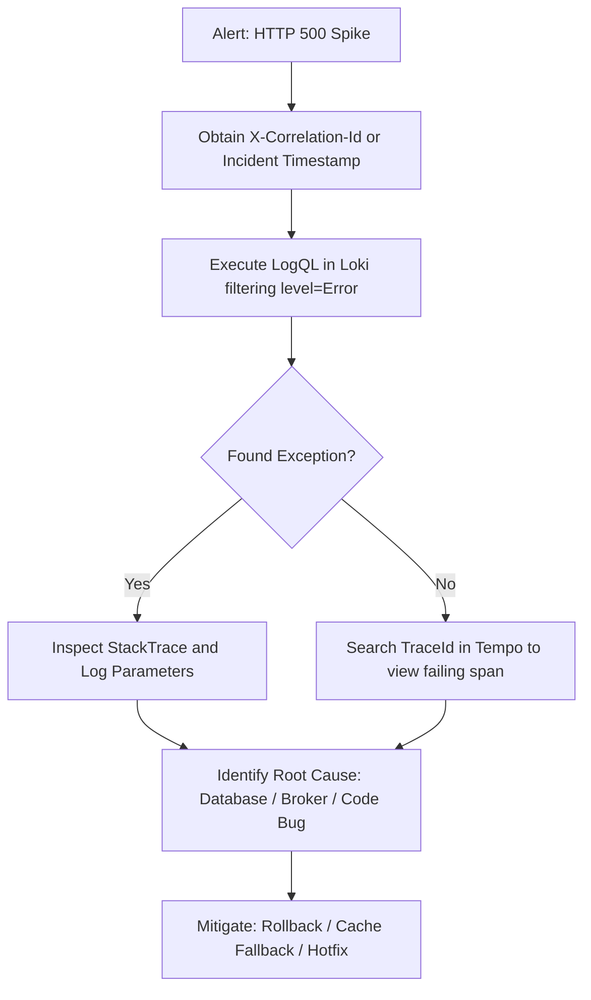

# SRE Operational Playbook & Incident Investigation Runbook

This document serves as the executable reference guide for **SRE Engineers**, **Developers**, and **Autonomous AI Agents** investigating anomalies, crashes, latency degradations, and security incidents within **MarketPulse Lab**.

---

## 1. Observability Architecture Topology

```
                        ┌─────────────────────────────────────────────────────────┐
                        │             MarketPulse.Api (.NET 9 C#)                 │
                        │  - System.Diagnostics.ActivitySource ("MarketPulse.Api")│
                        │  - System.Diagnostics.Metrics.Meter ("MarketPulse.Api") │
                        │  - ILogger Structured Logging Scope (CorrelationId)     │
                        └───────────────────────────┬─────────────────────────────┘
                                                    │
                                         Protocol: OTLP / HTTP (Protobuf)
                                         W3C TraceContext (traceparent)
                                                    │
                   ┌────────────────────────────────┴────────────────────────────────┐
                   │                                                                 │
                   ▼                                                                 ▼
      [ Production: Grafana Cloud ]                                    [ Local: Aspire Dashboard ]
      Endpoint: prod-sa-east-1                                          Endpoint: http://localhost:18888
      Stack: bigveranda1683.grafana.net                                 OTLP Port: 4317 (gRPC)
      ┌─────────────┬─────────────┬─────────────┐                      ┌─────────────────────────┐
      │    Tempo    │    Mimir    │    Loki     │                      │   Traces, Metrics &     │
      │   (Traces)  │  (Metrics)  │   (Logs)    │                      │     Structured Logs     │
      └─────────────┴─────────────┴─────────────┘                      └─────────────────────────┘
```

---

## 2. Telemetry Data Source Inventory & Access

| Pillar | Technology | Grafana Cloud Data Source | OTLP Endpoint |
| :--- | :--- | :--- | :--- |
| **Traces** | Grafana Tempo | `grafanacloud-bigveranda1683-traces` | `/otlp/v1/traces` |
| **Metrics** | Grafana Mimir (Prometheus) | `grafanacloud-bigveranda1683-prom` | `/otlp/v1/metrics` |
| **Logs** | Grafana Loki | `grafanacloud-bigveranda1683-logs` | `/otlp/v1/logs` |
| **Dashboard** | Grafana Dashboard | [MarketPulse Lab - SRE Golden Signals](https://bigveranda1683.grafana.net/d/pomrnx9/9de3a08) | N/A |
| **Local** | .NET Aspire Dashboard | `http://localhost:18888` | `localhost:4317` |

---

## 3. Executable Query Catalog for Incident Investigation

### 3.1. Metric Queries (PromQL) — Data Source: `grafanacloud-bigveranda1683-prom`

#### A. Overall Health and Error Rate
- **5xx Error Rate (SLO: < 0.1%)**:
  ```promql
  (sum(rate(http_server_request_duration_seconds_count{http_response_status_code=~"5.."}[5m])) / sum(rate(http_server_request_duration_seconds_count[5m]))) or vector(0)
  ```
- **Total Requests with Errors by Status Code**:
  ```promql
  sum by (http_response_status_code) (increase(http_server_request_duration_seconds_count[5m]))
  ```

#### B. Latency (p50, p95, and p99 Percentiles)
- **P95 Latency by Route (Alert if > 500ms)**:
  ```promql
  histogram_quantile(0.95, sum by (le, http_route) (rate(http_server_request_duration_seconds_bucket[5m])))
  ```
- **Median Latency (p50)**:
  ```promql
  histogram_quantile(0.50, sum by (le) (rate(http_server_request_duration_seconds_bucket[5m])))
  ```
- **Extreme Latency (p99)**:
  ```promql
  histogram_quantile(0.99, sum by (le) (rate(http_server_request_duration_seconds_bucket[5m])))
  ```

#### C. Traffic and Business Volume
- **Throughput by Route (Requests per Second)**:
  ```promql
  sum by (http_route, http_request_method) (rate(http_server_request_duration_seconds_count[1m]))
  ```
- **Volume of Currency Quotes Consulted by Base Currency**:
  ```promql
  sum by (currency_base) (marketpulse_rates_requests_total)
  ```

#### D. Saturation and Dependencies
- **Outbound HTTP Client Connections (Active/Idle)**:
  ```promql
  sum by (http_connection_state) (http_client_open_connections)
  ```

---

### 3.2. Structured Log Queries (LogQL) — Data Source: `grafanacloud-bigveranda1683-logs`

#### A. Investigate Errors and Exceptions
- **All Errors and Exceptions (Status >= 500 or Unhandled Exceptions)**:
  ```logql
  {service_name="agentic-pipeline-lab-api"} |~ "(?i)fail|error|exception|status 5"
  ```
- **Filter strictly by Log Level `Error`**:
  ```logql
  {service_name="agentic-pipeline-lab-api", level="Error"}
  ```

#### B. Trace Specific Request by Correlation Identifier
- **Filter execution stream by `CorrelationId`**:
  ```logql
  {service_name="agentic-pipeline-lab-api"} |= "CorrelationId: <TARGET_ID>"
  ```
- **Filter by `TraceId`**:
  ```logql
  {service_name="agentic-pipeline-lab-api"} |= "<TARGET_TRACE_ID>"
  ```

#### C. Investigate Slow Requests
- **Filter requests exceeding 500ms elapsed duration**:
  ```logql
  {service_name="agentic-pipeline-lab-api"} | json | elapsedMs > 500
  ```

---

### 3.3. Distributed Tracing Queries (TraceQL) — Data Source: `grafanacloud-bigveranda1683-traces`

#### A. Locate Errored Spans
- **Any trace containing an error**:
  ```traceql
  { status = error }
  ```

#### B. Locate High-Latency Requests
- **Traces with total duration exceeding 1 second**:
  ```traceql
  { duration > 1s }
  ```
- **Slow outbound requests to external Frankfurter API**:
  ```traceql
  { span.http.request.method = "GET" && span.server.address = "api.frankfurter.app" && duration > 500ms }
  ```

---

## 4. Incident Investigation Playbooks (Step-by-Step)

### Playbook A: Investigating Crash / HTTP 500 Internal Server Error

**Symptom:** The `Service Health Status` panel switches to `DEGRADED` or `5xx Error Rate` rises above 0%.



1. **Step 1 (Locate Error Log in Loki)**:
   Navigate to Grafana Explore -> Data Source `grafanacloud-bigveranda1683-logs` and run:
   ```logql
   {service_name="agentic-pipeline-lab-api"} |~ "failed with status 5|Unhandled exception"
   ```
2. **Step 2 (Extract Context)**:
   Inspect the log entry. The [`RequestTelemetryMiddleware.cs`](file:///d:/pipeline-dev-automatizador/src/backend/src/App.Api/Middleware/RequestTelemetryMiddleware.cs) captures:
   - `TraceId`: Trace identifier in Tempo.
   - `CorrelationId`: End-to-end transaction ID.
   - `RequestPath` and `RequestMethod`: Impacted route.
   - `Exception`: Exception type, message, and stack trace line numbers.
3. **Step 3 (View Waterfall in Tempo)**:
   Copy `TraceId` into Grafana Explore -> Data Source `grafanacloud-bigveranda1683-traces`.
   Inspect which node in the cascade threw the error (Domain layer, EF Core, or HttpClient).

---

### Playbook B: Investigating Latency Degradation (Elevated P95/P99)

**Symptom:** `P95 Latency` panel turns yellow (> 250ms) or red (> 500ms).

1. **Step 1 (Identify Offending Route)**:
   In Grafana Explore (Prometheus), run:
   ```promql
   topk(5, histogram_quantile(0.95, sum by (le, http_route) (rate(http_server_request_duration_seconds_bucket[5m]))))
   ```
2. **Step 2 (Examine Slow Spans in Tempo)**:
   In Tempo, run:
   ```traceql
   { resource.service.name = "agentic-pipeline-lab-api" && duration > 500ms }
   ```
   Select the slowest trace. The waterfall view reveals the longest bar:
   - **Longest bar is `ExchangeRates.GetQuote` / `api.frankfurter.app`**: The external currency provider is experiencing throttling or high latency. Solution: Verify `HybridCache` TTL or activate fallback cache.
   - **Longest bar is `Npgsql` / PostgreSQL**: Lock contention or heavy table scan without index.
   - **Longest bar is Kestrel API execution**: CPU saturation on host instance.

---

### Playbook C: Investigating Security Anomalies (BOLA / IDOR / Brute-Force Scanning)

**Symptom:** Spike in `HTTP Status Code Distribution` on `401 Unauthorized` or `404 Not Found` across secure routes.

1. **Step 1 (Identify Offending IPs and Routes)**:
   In Loki, run:
   ```logql
   {service_name="agentic-pipeline-lab-api"} |~ "completed with client error 40[14]"
   ```
2. **Step 2 (Evaluate BOLA / IDOR Attempt)**:
   Repeated `GET /api/v1/watchlist/{id}` requests returning `404` for sequential UUIDs under the same user indicate BOLA traversal testing. The system protects data via owner scoping as tested in [`MarketPulseApiIntegrationTests.cs`](file:///d:/pipeline-dev-automatizador/src/backend/tests/App.IntegrationTests/MarketPulseApiIntegrationTests.cs).
3. **Step 3 (Mitigation)**:
   The `RateLimiter` (`RateLimitPartition`) automatically applies `429 Too Many Requests` to abusive client partitions exceeding configured thresholds.

---

### Playbook D: Investigating Event-Driven Messaging (RabbitMQ / CloudAMQP)

**Symptom:** Rate alert messages not triggered, queue backlog building up, or disparity between `marketpulse_messaging_published_total` and `marketpulse_messaging_consumed_total`.

1. **Step 1 (Audit Message Lifecycle in Loki)**:
   Filter publish and consume logs:
   ```logql
   {service_name="agentic-pipeline-lab-api"} |= "EventBus"
   ```
   - **`[PUBLISH_START]` / `[PUBLISH_SUCCESS]`**: Confirms `CreateWatchItemUseCase` staged the event via MassTransit EntityFramework Outbox.
   - **`[CONSUME_START]` / `[CONSUME_SUCCESS]`**: Confirms `CurrencyAlertConsumer` received and processed the message from `marketpulse.currency-alerts`.
   - **`[CONSUME_SKIPPED_DUPLICATE]`**: Redelivered message dropped safely by the consumer's **idempotency** deduplication store.
   - **`[CONSUME_FAILED]`**: Exception caught during consumption. The message transitions to MassTransit exponential retries or the Dead Letter Queue (`_error`).

2. **Step 2 (Distributed Tracing in Tempo)**:
   Search Tempo for:
   ```traceql
   { span.name = "CurrencyAlertConsumer.Consume" }
   ```
   Inspect span attributes:
   - `messaging.system` = `rabbitmq`
   - `messaging.destination` = `marketpulse.currency-alerts`
   - `messaging.event_id` = Event UUID v7
   - `correlation.id` = Correlation ID propagated end-to-end from original HTTP request.

3. **Step 3 (CloudAMQP Metric Gauges in Prometheus)**:
   - **Message Rates**: `rate(marketpulse_messaging_published_total[1m])` vs `rate(marketpulse_messaging_consumed_total[1m])`.
   - **Consumer Latency**: `histogram_quantile(0.95, sum(rate(marketpulse_messaging_consume_duration_seconds_bucket[5m])) by (le))`.

---

## 5. Instructions for Autonomous AI Agents

When an AI Agent is summoned to diagnose an issue in this application:
1. Extract the `CorrelationId` or `TraceId` referenced in the prompt or issue ticket.
2. Query the exact telemetry source listed in Section 2.
3. Never assume root causes without correlating the **Error Log** with the **Trace Span**.
4. Confirm solution tests cover the scenario using `pwsh -File scripts/validate-all.ps1`.
5. Present in the final report: **Incident Timestamp**, **Trace ID**, **Failing Span**, **Proven Root Cause**, and **Corrective Pull Request**.
