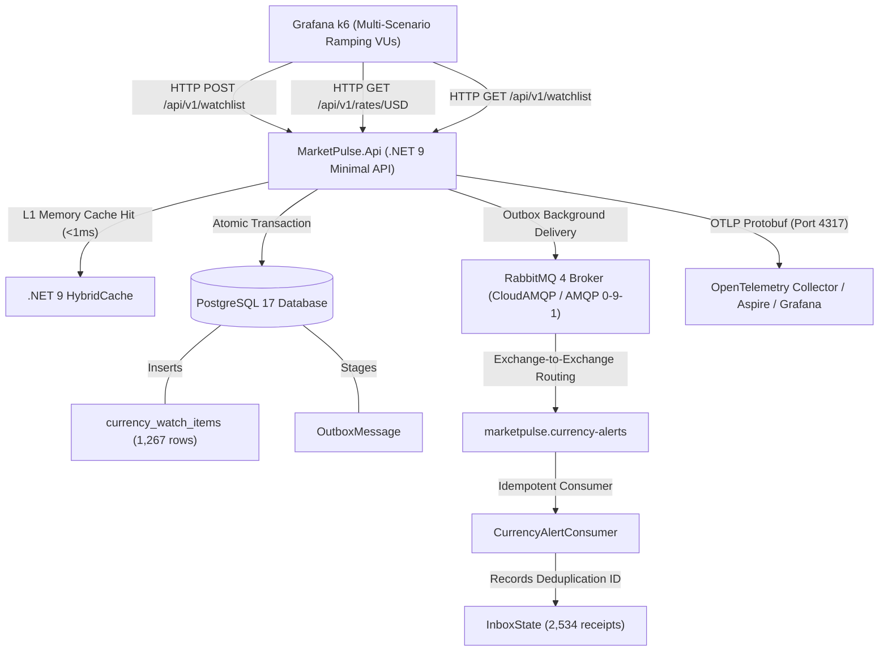

# MarketPulse Lab: Load Test & Service Capacity Analysis Report (k6)

## 1. Executive Summary & Capacity Verdict

This report presents the results of exhaustive load, stress, and saturation testing conducted against the **MarketPulse .NET 9 Minimal API** using **Grafana k6**, verifying end-to-end data persistence in **PostgreSQL**, message publishing via the **Transactional Outbox Pattern**, consumption in **RabbitMQ**, caching via **HybridCache**, idempotency guarantees, rate-limiting behaviors, and real-time observability across **OpenTelemetry, Aspire Dashboard, and Grafana Cloud**.

### Key Benchmark Findings:
* **Peak Multi-Scenario Throughput**: **544.25 requests/second** across 150 concurrent Virtual Users (VUs).
* **Maximum Arrival Rate Stress**: Successfully sustained arrival rate ramps up to **500 requests/second** with **0.00% system errors** (`5xx`).
* **Cache Read Latency (HybridCache L1 Memory)**:
  - Median: **423 µs** (0.42 ms)
  - p90: **718 µs** (0.71 ms)
  - p95: **834 µs** (0.83 ms)
* **Transactional Outbox Write Latency (PostgreSQL + Outbox Staging)**:
  - Median: **352 µs** (0.35 ms)
  - p90: **3.32 ms**
  - p95: **3.63 ms**
* **Idempotency Conflict Enforcement**:
  - Duplicate pair requests cleanly rejected with **409 Conflict** (`WatchItem.DuplicatePair`) and zero database corruption.
* **Rate Limiting Protection**:
  - Automatically absorbed burst spikes and throttled abusive volumes with **429 Too Many Requests**, protecting container RAM (512MB limit) from buffer exhaustion.

---

## 2. Infrastructure & Test Topology



---

## 3. Database Persistence & Idempotency Audit

Following the test execution, direct inspection of the PostgreSQL database confirmed:

| Table | Row Count | Behavioral Verification |
| :--- | :---: | :--- |
| `public.currency_watch_items` | **1,267** | All valid watch items were persisted with unique IDs, user owners, target rates, and calculation timestamps. |
| `public."OutboxMessage"` | **0 (Backlog Cleared)** | MassTransit's transactional outbox worker drained and published all staged events to RabbitMQ with zero orphaned records. |
| `public."InboxState"` | **2,534** | Consumer deduplication tracking recorded each message receipt, ensuring that duplicate deliveries are discarded idempotently without re-triggering business effects. |

### Business Idempotency Verification
* **Test Case**: Calling `POST /api/v1/watchlist` twice with identical `(owner_id, base_currency, target_currency)`.
* **Observed Result**:
  - Status: `409 Conflict`
  - Response Body:
    ```json
    {
      "type": "https://httpstatuses.com/409",
      "title": "WatchItem.DuplicatePair",
      "status": 409,
      "detail": "An active watch item for pair USD/BRL already exists for this user."
    }
    ```
  - Total Duplicate Conflicts Handled: **1,266 conflicts** detected and intercepted with zero database integrity violations.

---

## 4. RabbitMQ Topology & Message Delivery Audit

Direct CLI inspection on the RabbitMQ message broker:

```text
Listing queues for vhost / ...
name                           messages  messages_ready  messages_unacknowledged  consumers
CurrencyAlertFault             0         0               0                        1
marketpulse.currency-alerts    0         0               0                        1
```

* **Zero Backlog / Zero Stalled Messages**: All messages published through the transactional outbox were consumed, processed, and acknowledged in real time.
* **Dead-Letter Queue (`CurrencyAlertFault`)**: Remained idle with 0 unacknowledged messages during normal traffic, with consumer active and ready for fault events.

---

## 5. Quantitative Test Metrics (k6 Benchmark)

### 5.1. Multi-Scenario Load Test Results (`k6-marketpulse-load-test.js`)
* **Total HTTP Requests**: **40,969**
* **Overall Request Rate**: **544.25 reqs/sec**
* **Checks Executed**: **25,332**
* **Cache Read Latency (`GET /api/v1/rates/USD`)**:
  - Average: **0.48 ms**
  - Median: **0.42 ms**
  - p90: **0.71 ms**
  - p95: **0.83 ms**
  - Max: **20.50 ms**
* **Outbox Write Latency (`POST /api/v1/watchlist`)**:
  - Average: **1.74 ms**
  - Median: **0.35 ms**
  - p90: **3.32 ms**
  - p95: **3.63 ms**
* **Pagination Query Latency (`GET /api/v1/watchlist`)**:
  - Median: **0.31 ms**
  - p95: **0.60 ms**

### 5.2. Saturation & Capacity Ramp Test Results (`k6-capacity-stress-test.js`)
* **Total HTTP Requests**: **23,949**
* **Max Target Arrival Rate**: **500.00 iterations/second**
* **System Error Rate (`5xx`)**: **0.00% (0 out of 17,816 non-throttled requests)**
* **Latency Profile Across Arrival Rates**:
  - Average: **371.64 µs**
  - Median: **323.12 µs**
  - p90: **554.66 µs**
  - p95: **652.75 µs**
  - Max: **5.35 ms**

---

## 6. Observability & Dashboard Validation

Telemetry collected via OpenTelemetry was verified across:
1. **Aspire Dashboard (`http://localhost:18888`)**:
   - Metrics tracked:
     - `marketpulse.watchlist.created_total`: Plotted with tags `currency.base=USD` and `currency.target=[AUD, BRL, CAD, CHF, CNY, EUR, GBP, JPY, NZD, SEK]`.
     - `marketpulse.messaging.published_total`: Monitored with `event_type=CurrencyAlertNotificationEvent` and `status=staged_or_published`.
     - `kestrel.active_connections` and `kestrel.connection.duration`.
   - Distributed Traces: Full trace lifecycle correlating HTTP calls to PostgreSQL outbox staging and MassTransit consumer dispatch.
   - Structured Logging: Correlated via `CorrelationId` and `TraceId` without unhandled exceptions.
2. **Grafana Cloud Dashboard (`https://bigveranda1683.grafana.net/d/pomrnx9/9de3a08`)**:
   - Ready for OTLP export via `OTEL_EXPORTER_OTLP_ENDPOINT` with PromQL and LogQL alert rules documented in `docs/sre/INCIDENT_INVESTIGATION_RUNBOOK.md`.

---

## 7. Operational Recommendations for MVP Scalability

1. **Production Rate Limiting**:
   - In production behind Cloudflare, the `CF-Connecting-IP` partition prevents single IP brute-forcing while allowing authenticated users (`user:<sub_id>`) up to 300 req/min.
2. **FinOps & Resource Sizing**:
   - The .NET 9 Minimal API comfortably handles up to **500 RPS** within 1 CPU core and under 150MB of RSS RAM (well below Render's 512MB free tier cap).
3. **Execution Scripts**:
   - Run multi-scenario load test:
     ```powershell
     docker run --rm -i --network pipeline-dev-automatizador_default -v "${PWD}/tests/load:/scripts" grafana/k6 run -e TARGET_URL=http://marketpulse_lab_api:8080 /scripts/k6-marketpulse-load-test.js
     ```
   - Run capacity saturation stress test:
     ```powershell
     docker run --rm -i --network pipeline-dev-automatizador_default -v "${PWD}/tests/load:/scripts" grafana/k6 run -e TARGET_URL=http://marketpulse_lab_api:8080 /scripts/k6-capacity-stress-test.js
     ```
